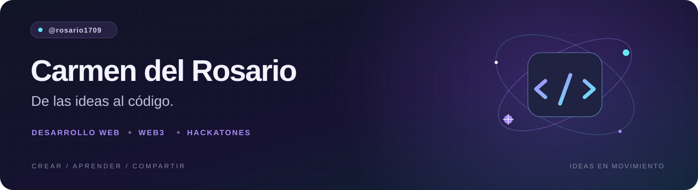
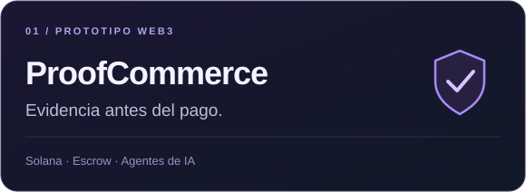
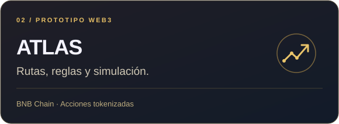
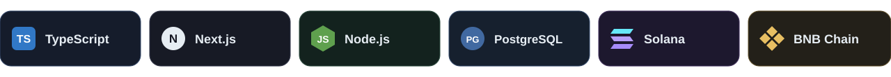

  

  <strong>De las ideas al código. Del código a proyectos que se pueden probar.</strong>

  <a href="https://github.com/rosario1709?tab=repositories">Explora mis proyectos</a>
  &nbsp; · &nbsp;
  <a href="mailto:u20171a528@upc.edu.pe">Conversemos</a>

---

### 👋 Hola, soy Carmen del Rosario

Trabajo en proyectos que combinan **desarrollo web, blockchain y agentes de inteligencia artificial**. Me interesa convertir ideas complejas en prototipos que se puedan entender, probar y mejorar.

Este perfil reúne mis proyectos, lo que voy aprendiendo y las soluciones que exploro en hackatones.

### 🚀 Proyectos destacados

<table>
  <tr>
    <td width="50%" valign="top">
      
      
Prototipo de infraestructura para el comercio entre agentes de IA: acuerdos, evidencias y pagos condicionados mediante <strong>escrow en Solana</strong>.

      
<a href="https://github.com/rosario1709/CriptoWorldsFair"><strong>Explorar ProofCommerce →</strong></a>

    </td>
    <td width="50%" valign="top">
      
      
Prototipo para explorar acciones tokenizadas en <strong>BNB Smart Chain</strong>: comparación de rutas, políticas deterministas, simulación y recibos auditables.

      
<a href="https://github.com/rosario1709/BNB-Hackaton"><strong>Explorar ATLAS →</strong></a>

    </td>
  </tr>
</table>

### 🛠️ Tecnologías presentes en estos proyectos

  

### 🧭 Lo que me interesa construir

- **Aplicaciones web** que ayuden a resolver problemas concretos.
- **Agentes de IA** con reglas claras y resultados verificables.
- **Soluciones con blockchain** que conecten acuerdos, evidencia y ejecución.
- **Prototipos para hackatones** que conviertan una propuesta en una experiencia funcional.

### 🤝 Conectemos

Me interesa colaborar en proyectos, compartir aprendizajes y participar en retos tecnológicos.

**Correo:** [u20171a528@upc.edu.pe](mailto:u20171a528@upc.edu.pe)  
**GitHub:** [@rosario1709](https://github.com/rosario1709)

---

  Crear con intención · Aprender construyendo · Compartir el proceso

